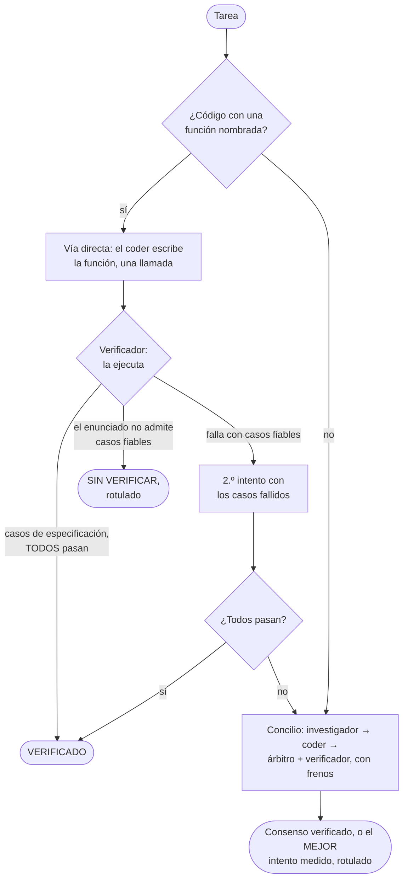

# Concilio — modelos locales que comprueban su propio trabajo

> Rama `local/concilio` del monorepo [`Inzainos/Local`](https://github.com/Inzainos/Local). Ver también `local/home-bridge`, `local/padron`, `local/sentinel-omega` y `local/watchdog`.
> Origen local: `/home/deamon/consensus-expert-agent` en WSL2 Kali (**deamon** / X-Deamon). Licencia: [MIT](LICENSE).

> **Home workspace:** reglas duras y mapa de proyectos en [`/home/deamon/AGENTS.md`](../AGENTS.md). Guía local para agentes: [`AGENTS.md`](./AGENTS.md).

Sistema multi-agente local sobre **Ollama**. La idea central de la **v1**: un modelo no decide si
su código funciona **leyéndolo** — lo **ejecuta**. Medido el 2026-09-24/25, el árbitro leyendo puso
92–99 de nota a códigos que rechazaban todos los casos válidos; ejecutándolos, suspendían.

---

## Cómo funciona (v1)



**El verificador** construye los casos de prueba **desde el enunciado**, nunca desde la solución:

- Para **validadores de formato** (tokens, matrículas…), un modelo extrae la especificación
  —campos, longitudes, separadores— y **Python construye** casos balanceados de frontera: el
  válido, uno más largo, uno más corto, sin separador, con un carácter prohibido. Un modelo lee
  «35»; `len()` cuenta hasta 35. Con estos casos se exigen **todos**.
- Para el resto, los casos los derivaría un modelo, y eso no es fiable: medido, aprobaron código
  roto una noche y bloquearon código correcto la siguiente. Esas tareas se entregan **rotuladas
  SIN VERIFICAR** en vez de aprobarse mal.

Por qué la vía directa: codegemma resolvió 6 de 7 tareas a la primera en ~30 s cada una; el
concilio tardaba 25–50 minutos por tarea. En la batería de aceptación de la v1, seis de las siete
tareas salieron por la vía directa en 11,7 minutos entre todas; la séptima escaló al concilio
(14,3 min) y no cerró — sin consenso falso, que es el criterio de «estable».

---

## Modelos (todos elegidos midiendo)

| rol | modelo | ventana | medición que lo decidió |
|---|---|---|---|
| coder | `codegemma:7b` (respaldo `qwen2.5-coder:7b`) | 8.192 | 6/7 tareas, 72/73 casos a la primera; qwen 5/7, 60/73 |
| extractor de formato | `qwen2.5-coder:7b` | 4.096 | el único de 5 que extrajo bien la especificación |
| investigador | `concilio-investigador` (llama3.2:3b) | 16.384 | |
| árbitro | `concilio-arbitro` (gemma3:4b) | 16.384 | lee y sintetiza; no decide si el código funciona |

Caché KV de Ollama en `q8_0` + flash attention: `concilio-medium` a 16.384 pasó de 7,28 a
6,21 GiB con +13 % de velocidad y sin pérdida en las sondas de calidad. El techo útil por modelo
en esta máquina es ~7,3 GiB con Sentinel corriendo; `deepseek-r1:14b` no cabe.

---

## Inicio rápido

```bash
cd /home/deamon/consensus-expert-agent
.venv/bin/python main.py --check
.venv/bin/python main.py --task "Escribe una funcion Python llamada es_ipv4(s: str) -> bool que ..."
.venv/bin/python main.py --web --port 8000
.venv/bin/python -m pytest tests/ -q -rs        # con el intérprete del entorno
```

### Telegram bot

```bash
cp .env.example .env   # TELEGRAM_BOT_TOKEN / TELEGRAM_CHAT_ID (solo env; no hardcode)
./run_telegram_bot.sh
```

`/task` va por la vía ligera; `/concilio` por `run_consensus` (vía directa y, si hace falta,
concilio). El bot, el CLI y la web muestran los tres desenlaces: **Verificado por ejecución**,
**SIN VERIFICAR** y el resultado del concilio. Detalle: [`TELEGRAM_BOT_README.md`](./TELEGRAM_BOT_README.md).

---

## Configuración clave (`config.yaml`)

```yaml
consensus:
  threshold_score: 85              # sólo para lo que no se puede ejecutar
  max_refinement_rounds: 0         # sin tope fijo: paran los frenos de abajo
  rondas_sin_mejora_para_parar: 4  # mejora = por encima del ruido medido (σ 6,9)

concilio:
  worker_model: concilio-investigador
  coder_model: codegemma:7b
  arbiter_model: concilio-arbitro
  extractor_formato: qwen2.5-coder:7b
  segmentador: ""                  # desactivado: empeoraba al coder (medido)
  via_directa: true
  intentos_directos: 2
  sin_verificacion_confiable: entregar
  inject_sentinel_architecture: false
```

Cada opción lleva en `config.yaml` la medición que la justifica.

---

## Qué no hace la v1

- **Investigación y análisis no se verifican**: no hay nada que ejecutar.
- Código que no es validador de formato sale **sin verificar** (falta la verificación por
  relaciones: `f('1h30m') == f('1h') + f('30m')`).
- El motor de turnos por niveles (`engine/turnos*.py`, `profiles/niveles.yaml`) está escrito y
  probado, pero **no cableado**. El índice vectorial, pendiente.

Las tuberías anteriores están retiradas en [`legacy/`](./legacy/README.md).

---

## Relación con el home / Sentinel

| Pieza | Path / nota |
|-------|-------------|
| Home AGENTS | `/home/deamon/AGENTS.md` |
| Stub reglas (opt) | `data/memory_packs/home_hard_rules_stub.md` |
| Pack Sentinel (opt-in) | `data/memory_packs/sentinel_omega_pack.md` sólo si inject=true |
| Sentinel ↔ Ollama | Sentinel sólo consulta la salud (`/api/tags`), no pide inferencias |

Protocolo del concilio: [`CONCILIO.md`](./CONCILIO.md). Historial: [`CHANGELOG.md`](./CHANGELOG.md).
